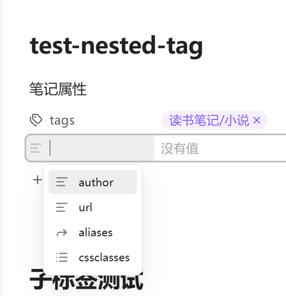
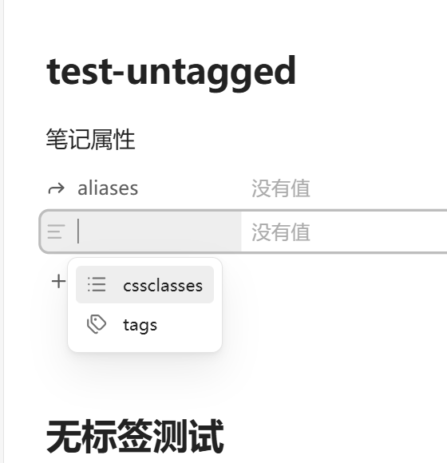
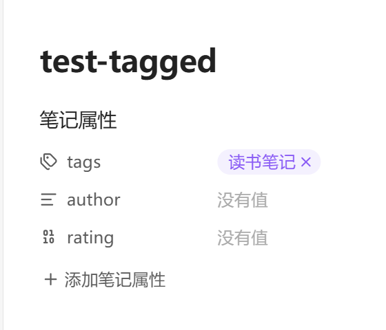
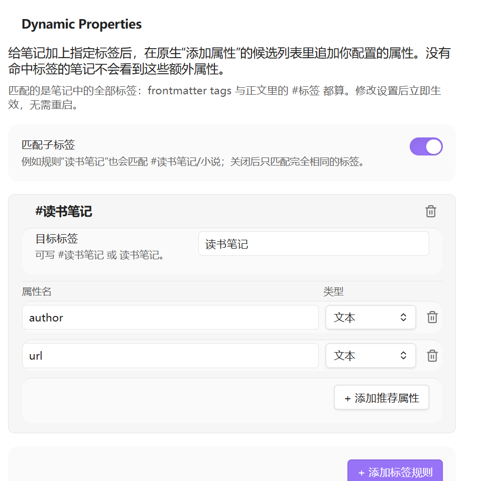

# Dynamic Properties

Dynamic Properties extends Obsidian's native property-name suggestions based on the tags of the current note. Notes that do not match a configured tag keep the native suggestion list and do not show any extra properties.
This is a small AI-assisted plugin I built to solve my own workflow needs.

> Dynamic Properties 会根据当前笔记的标签，扩展 Obsidian 原生“添加属性”的候选列表；没有命中标签的笔记保持原生列表，不显示这些额外属性。
> 这是我为解决自己的需求、借助 AI 编写的一个小插件喵。

## What it does / 功能

- When a note contains `#读书笔记` (in frontmatter `tags` or as an inline tag), clicking **Add property** in the property panel shows configured candidates such as `author` and `url` at the top of the native list.
- Selecting `author` adds the property and applies the configured `Text` type. Selecting `rating` with the `Number` type writes the type to `.obsidian/types.json`.
- Notes without a matching tag never see these extra candidates. Even if a property name already exists in the global `types.json`, it is filtered out for non-matching notes so the native list stays clean.
- Nested tags match by default: the rule `读书笔记` also matches `#读书笔记/小说`. This behaviour can be disabled in settings.
  

  > 当笔记包含 `#读书笔记`（frontmatter `tags` 或正文标签均可）时，点击属性面板的“添加属性”，候选列表顶部会出现 `author`、`url` 等配置属性。
  > 选择 `author` 后会新增该属性，并应用配置的“文本”类型；选择配置为“数字”的 `rating` 时，类型会写入 `.obsidian/types.json`。
  > 没有命中标签的笔记不会出现这些额外属性；即使同名属性已经写入全局 `types.json`，也会被过滤掉，避免污染原生列表。
  > 子标签默认匹配：规则 `读书笔记` 同时匹配 `#读书笔记/小说`，可在设置中关闭。

## Screenshots / 验收截图

The screenshots below were taken with real mouse clicks in Obsidian 1.14.5 on Windows. The Obsidian interface is in Chinese; this README is bilingual.

> 以下截图是在 Obsidian 1.14.5 / Windows 上用真实鼠标点击得到的。Obsidian 界面为中文，README 为英中双语。

A note with a `#读书笔记/小说` sub-tag:

> 带有 `#读书笔记/小说` 子标签的笔记：



A note without a matching tag; only the native `cssclasses` and `tags` candidates remain:

> 没有命中标签的笔记，仅保留原生 `cssclasses`、`tags` 候选：



After selecting a property configured as `number`, the property row uses a number control and the type is written to `types.json`:

> 选中配置为 `number` 的属性后，属性行会显示数字控件，类型同时写入 `types.json`：



Settings page:

> 设置页：



## How it works / 技术方案

Obsidian's native property-name input is backed by a subclass of `AbstractInputSuggest`, and its suggestion container is marked with `mod-property-key`. The plugin does two things:

> Obsidian 原生属性名输入框使用 `AbstractInputSuggest` 的子类，并给 suggest 容器加上 `mod-property-key` 标记。插件只做两件事：

1. It wraps `AbstractInputSuggest.prototype.showSuggestions`. For property-key suggestions only, it merges the recommendations for the current file into the native candidate array. When the note does not match a tag, it removes all plugin-managed property names from the native suggestions.
   > 包装 `AbstractInputSuggest.prototype.showSuggestions`。只对属性名 suggest 生效：把当前文件命中的推荐属性合并进原生候选数组；未命中标签时，从原生候选中移除所有由插件管理的属性名。

2. It wraps `selectSuggestion`. When a recommended property is selected from the native list, it applies the configured type through `app.metadataTypeManager.setType()`.
   > 包装 `selectSuggestion`。当用户从原生列表选择推荐属性后，通过 `app.metadataTypeManager.setType()` 应用配置的类型。

An `EditorSuggest` or a separate command would not preserve the native “click Add property” flow. The patch keeps the original property panel and only changes the candidate data. There is no global polling and no DOM observer, and the prototype methods are restored when the plugin unloads.

> `EditorSuggest` 或独立命令都无法保留“点击原生添加属性”的完整流程。这个补丁保留原生属性面板，只改候选数据；没有全局轮询，也没有 DOM 观察器，插件卸载时会还原原型方法。

> **Compatibility note:** `AbstractInputSuggest` and `metadataTypeManager.setType()` are available exports/internal APIs, not a stable official contract. The plugin checks for them and degrades gracefully; if a future Obsidian release breaks them, a warning is printed to the console.
>
> `AbstractInputSuggest` 与 `metadataTypeManager.setType()` 是当前可用的导出/内部 API，不是官方稳定契约。插件会做能力检测和失败降级；如果未来 Obsidian 版本使其失效，会在控制台输出警告。

## Settings schema / 设置结构

```ts
interface DynamicPropertiesSettings {
  matchNestedTags: boolean;
  rules: Array<{
    id: string;
    tag: string;
    properties: Array<{
      name: string;
      type: "text" | "number" | "list" | "date" | "datetime" | "checkbox";
    }>;
  }>;
}
```

The default rule is `读书笔记` → `author` (text) and `url` (text). Rules, properties and types can be added, removed or changed in the settings page.

> 默认规则是 `读书笔记` → `author`（文本）、`url`（文本）。可以在设置页增删规则、增删属性、切换类型。

Tag matching reads:

> 标签匹配会读取：

- frontmatter `tags` and `tag`
  > frontmatter 的 `tags` / `tag`
- inline `#tags` in the note body, as provided by `metadataCache`
  > 正文中的 `#标签`（由 `metadataCache` 提供）

The plugin listens to `metadataCache`'s `changed` event to maintain a per-note recommendation cache. The property panel reads that cache when it opens; there is no polling.

> 插件监听 `metadataCache` 的 `changed` 事件，维护每篇笔记的推荐缓存；属性面板打开候选时读取缓存，不做轮询。

## Project structure / 项目结构

```text
obsidian-dynamic-properties/
├─ manifest.json
├─ versions.json
├─ package.json
├─ package-lock.json
├─ tsconfig.json
├─ esbuild.config.mjs
├─ styles.css
├─ main.js                  # built plugin bundle
├─ README.md
├─ LICENSE
├─ docs/                    # screenshots
└─ src/
   ├─ main.ts               # lifecycle, cache, type application
   ├─ property-suggest.ts   # AbstractInputSuggest patch
   ├─ settings-tab.ts       # graphical settings page
   ├─ tags.ts               # tag reading, matching, recommendation resolution
   └─ types.ts              # settings and type definitions
```

## Build and install / 构建与安装

```bash
npm install
npm run build
```

Copy these files into:

> 把以下文件复制到：

```text
<vault>/.obsidian/plugins/acloudofdream_dynamic-properties/
├─ manifest.json
├─ main.js
└─ styles.css
```

Then enable **Dynamic Properties** under Obsidian's community plugins.

> 然后在 Obsidian 的“第三方插件”中启用 **Dynamic Properties**。

Development mode:
> 开发模式：

```bash
npm run dev
```

`esbuild` watches the source and writes `main.js`.

> `esbuild` 会监听源码并输出 `main.js`。

GitHub repository: [acloudofdream/obsidian-dynamic-properties](https://github.com/acloudofdream/obsidian-dynamic-properties)

> GitHub 仓库：[acloudofdream/obsidian-dynamic-properties](https://github.com/acloudofdream/obsidian-dynamic-properties)

## Security and privacy / 安全与隐私

The plugin makes no network requests, collects no telemetry, and does not handle accounts, passwords or tokens. It reads the current note's metadata cache and writes only to the current note's frontmatter and, when a recommended type is selected, to `.obsidian/types.json`.

Property types are a global Obsidian concept: writing a type for `author` or `rating` affects that property name across the vault. The plugin only controls whether a candidate is shown.

> 插件不会发起网络请求、不收集遥测，也不处理账号、密码或 token。它只读取当前笔记的 metadata cache，并只在当前笔记 frontmatter 以及用户选择推荐类型时写入 `.obsidian/types.json`。
> 
> 属性类型是 Obsidian 的全局概念：为 `author` 或 `rating` 写入类型后，该属性名在整个 vault 中都会使用这个类型。插件只控制候选是否出现，不改变类型系统的全局语义。

## Known limitations / 已知限制

- Property types are global. Writing `.obsidian/types.json` affects the property name in all notes; the plugin only manages candidate visibility.
- If another plugin also wraps the same `AbstractInputSuggest` method, this plugin only restores its own wrapper on unload, so another plugin's patch is not removed accidentally.
- Built-in `tags`, `aliases` and `cssclasses` are reserved and always keep their native behaviour; the settings page marks them as invalid.

  > 属性类型是全局的。写入 `.obsidian/types.json` 会影响该属性名在所有笔记中的类型；插件只管理候选是否显示。
  > 如果其他插件也包装了 `AbstractInputSuggest` 的同一方法，本插件卸载时只会在当前方法仍是本插件包装版时还原，避免误删其他插件的补丁。
  > 内置的 `tags`、`aliases`、`cssclasses` 保留原生逻辑；设置页会将它们标记为不可用。

## License / 许可证

[MIT](LICENSE) © 2026 acloudofdream
